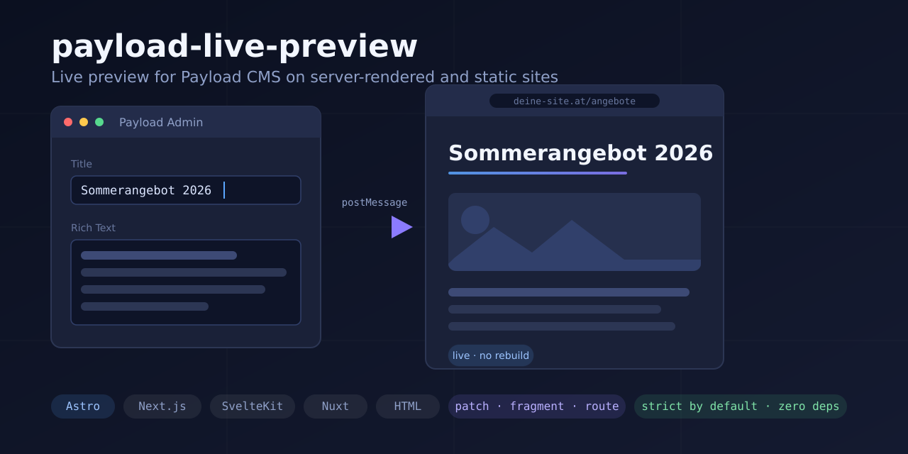

# payload-live-preview

[](https://github.com/relative23/payload-live-preview/actions/workflows/ci.yml)
[](LICENSE)
[](package.json)
[](#compatibility)
[](https://www.npmjs.com/package/payload-live-preview)



> **Live preview for Payload CMS on server-rendered and static sites** — Astro, Next.js, SvelteKit, Nuxt and plain HTML.

Payload publishes the framework-independent `@payloadcms/live-preview` client and the official `@payloadcms/live-preview-react` and `@payloadcms/live-preview-vue` wrappers. Those hooks feed a hydrated component tree; they do not own server markup outside that tree. This package covers that markup. Mark one boundary per server-rendered component, or individual fields on a static page, and edits reach the iframe as the editor types. Scalar patches and successful fragment renders need neither a rebuild nor a full-page reload; a route-level change uses the configured route refresh. Client-rendered apps can instead use this package's React or Vue entry. Its v2 sanitizer and request-time policy defaults are strict; static delivery has no request to authorize. The package has no direct dependencies; framework entries use optional peers.

One runtime serves every framework. The Astro, Next.js, SvelteKit and Nuxt adapters authorize a preview request, merge `frame-ancestors` into your CSP and render fragment boundaries on your server, and each adapter's example app runs end to end against a real Payload admin in Chromium, Firefox and WebKit on every push to `main` and on pull requests. Where the adapters differ, the difference comes from the framework: [Frameworks](#frameworks) lists it.

**New here?** Configure Payload, then add your framework's adapter under [Quick start](#quick-start). The [documentation index](docs/README.md) has the reading path.

## Highlights

- **One runtime, every frontend.** One TypeScript runtime compiled to a self-contained inline script of about 48 KB gzip — 37 KB with the lean artifact, 48 to 50 KB once the route or fragment prelude is appended ([docs/options.md](docs/options.md)). The adapters for Astro, Next.js, SvelteKit and Nuxt deliver it; where they decide per request they also authorize the request, merge `frame-ancestors` into your CSP and mark the changed response `private, no-store`. They provide the fragment endpoint and, outside Astro, the route that serves the runtime asset.
- **Patch, fragment, route.** A binding is patched in place; a `data-payload-fragment` boundary is rendered again by your server from the unsaved form state; a patch that fell short, or a change nothing binds, goes to the fragment render or a route refresh when the page has one ([below](#patch-fragment-route)).
- **Delivery.** Inline, or a bootstrap that fetches the content-hashed, SRI-verified runtime only inside a preview (`delivery: 'asset'`; Astro's static equivalent is `mode: 'loader'`). Where something decides per request — Astro's middleware, `await LivePreviewScript(…)` in Next.js, the SvelteKit handle, the Nuxt Nitro plugin — a public visitor receives no script at all ([docs/deployment.md](docs/deployment.md#what-a-public-visitor-pays)).
- **Payload 3.x native.** `serverURL` re-fetches the populated document, like the official client, so relationship and upload fields render as content rather than as IDs — but only when an edit needs one: in the DOM runtime, typing into a text field costs no request, and a burst on a relationship costs two requests, at its start and its end, rather than one per keystroke.
- **Lexical renderer.** 20 node types including `upload`, `relationship`, `block`, `autolink`, tabs, indent and RTL, with rich-text detection from the value shape, which also decides when Payload is asked to fill in uploads and relationships. An unknown node renders only its children; a block with no registered renderer becomes an empty placeholder, and the live write keeps the markup your server rendered in its place when the two trees line up. The prebuilt inline runtime cannot register block renderers.
- **Hooks for client-rendered apps.** `useLivePreviewDocument()` from `payload-live-preview/react` or `/vue` hands the merged document to your component tree ([docs/react.md](docs/react.md), [docs/vue.md](docs/vue.md)).
- **Tooling.** `pll doctor <url>` requests a page as a visitor and as the admin's iframe and reports the difference; `pll migrate` rewrites 1.x APIs to their 2.0 names; `pll-codegen` generates types from the Payload config, and `pll-codegen annotate` finds the bindings a template can take unambiguously.
- **Authorization before anything privileged.** Where an adapter decides per request with `authorizePreview`, draft reads, runtime injection, CSP changes and binding attributes follow one verified decision, and the client-controlled intent signals unlock nothing. The setups that decide less are named under [Security model](#security-model).
- **Strict by default.** Escape-by-default sanitizer, URL and `srcset` validation, policed attribute writes, prototype-pollution guards, per-instance clients, typed bindings with `pll-codegen`.
- **Also in the box.** `revealEditedField` scrolls the field being typed in into view ([docs/reveal.md](docs/reveal.md)); a hydrated island keeps its subtree and re-renders itself from a `payload-live-preview:update` event ([docs/hybrid.md](docs/hybrid.md#islands-on-the-same-page)); `data-payload-owner` scopes bindings on a page that previews several documents, `PreviewBoundary` keeps an anchor for a field that is still empty, and `autoBind: 'unique'` finds bindings by value ([docs/bindings.md](docs/bindings.md)); array items render from a template through a keyed morph (`payload-live-preview/structural`); an `aria-live` region announces connect, update and disconnect; the runtime binds again after a back/forward-cache restore or a soft navigation, and the Next.js, SvelteKit and Nuxt adapters wait for hydration before the first write.

## Compatibility

| Payload | Status                                     | Checked by                                                                                                                                                                                                         |
| ------- | ------------------------------------------ | ------------------------------------------------------------------------------------------------------------------------------------------------------------------------------------------------------------------ |
| 2.x     | supported in 2.x; ends with 3.0            | the 2.32.3 wire corpus replayed in CI; real-admin release checks of the DOM runtime and the React and Vue hooks ([docs/testing.md](docs/testing.md#local-release-checks))                                          |
| 3.x     | supported                                  | the real admin on every push (3.92.1, three engines); the 3.85, 3.88 and 3.89 wire corpora replayed in CI                                                                                                          |
| 4.x     | pre-release, the direction of this package | the 4.0.0-beta.4 and 4.0.0-beta.6 wire corpora replayed in CI; the real-admin suite against `payload@beta` every day, as an early warning; a 2.2 release candidate on a site running 4.0.0-beta.4 with Astro 7.4.2 |

**Payload 4** is where this package is headed. Its pre-releases are followed as they appear, and support becomes official with the stable 4.0 release; until then the daily run against `payload@beta` warns early and does not gate a release. The Payload 4 pre-release captured so far passes the same protocol checks as the 3.x corpora. As of 4.0.0-beta.4, Payload 4 needs Node 24.22.1 or later, and its admin Next.js 16.4 or a later 16.x release. Payload 2.x support ends with the next major release of this package: 3.0 supports Payload 3.x and 4.x, and every 2.x release keeps supporting Payload 2 ([ADR 0007 ledger, entry 25](docs/architecture/0007-v2-defaults-and-renames-ledger.md#ledger), [Preparing for 3.0](docs/migration.md#preparing-for-30)). 3.0 also needs Node 22 or newer and drops no framework major (entries 28 and 29). Payload 3.x stays supported. The manifest declares `payload` as an optional peer, `^2.0.0 || ^3.0.0 || ^4.0.0-0`: npm never installs it, and a project that has Payload outside that range gets npm's `ERESOLVE` error.

What differs between Payload 2, 3 and 4:

|                                                | Payload 2.x                                                                                                                                              | Payload 3.x                                                           | Payload 4.x (measured on 4.0.0-beta.4)                                  |
| ---------------------------------------------- | -------------------------------------------------------------------------------------------------------------------------------------------------------- | --------------------------------------------------------------------- | ----------------------------------------------------------------------- |
| Scalar field updates                           | ✅                                                                                                                                                       | ✅                                                                    | ✅                                                                      |
| Rich text (Lexical)                            | ✅                                                                                                                                                       | ✅                                                                    | ✅ through a fragment render; the client-side renderer not measured yet |
| Relationship / upload population               | Collection GETs from the accepted schema with `serverURL` and matching depth (relationships measured against a real 2.32.3 admin, uploads by unit tests) | ✅ with `serverURL` (REST merge)                                      | not measured yet                                                        |
| Schema-driven field typing (`fieldSchemaJSON`) | ✅                                                                                                                                                       | — (3.x removed it; DOM heuristics + Lexical auto-detection take over) | — (as in 3.x)                                                           |

<!-- compat-matrix:start -->

| Framework | Supported                                                                         | Tested in CI on every push (version, browsers)                                    |
| --------- | --------------------------------------------------------------------------------- | --------------------------------------------------------------------------------- |
| Astro     | >=4.0.0 <8.0.0                                                                    | 7.4.2 (chromium, firefox, webkit); 6.x (chromium); 5.x (chromium); 4.x (chromium) |
| Next.js   | App Router, 15.5 and 16                                                           | 16.4.3 (chromium, firefox, webkit); 15.x (chromium)                               |
| SvelteKit | 2.x and 3.x                                                                       | 3.1.1 (chromium, firefox, webkit); 2.70.3 (chromium, firefox, webkit)             |
| Nuxt      | 4.x; 3.x (end of life since 31 July 2026: kept working, not officially supported) | 4.6.3 (chromium, firefox, webkit); 3.21.11 (chromium, firefox, webkit)            |

Node >=20.19.0; the unit and integration suites run on Node 20, 22, 24, 26. Every version in the table is what the fixture lockfile or the matrix job installs, checked by `npm run compat:check`.

Of the 61 feature rows of `quality/compat-matrix.json`, 55 passed in the CI run the last Version PR recorded (commit `c9ffe5d`, 2026-11-01, `quality/compat-results.json`); the other 6 have no recorded result.

Vite 5 through 8: that is what the supported framework majors install (Astro 7 → 8, Astro 6 → 7, Astro 5 → 6, Astro 4 → 5, SvelteKit 3 → 8, SvelteKit 2 → 5/6/7/8, Nuxt 4 → 8, Nuxt 3 → 7), measured 2026-10-31. `npm run compat:check` keeps the devDependency and the fixture lockfiles inside that span; `npm run compat:refresh` re-reads it from the registry.

The framework hooks and fragment renderers run twice on every push: at the floor of each peer range, as unit tests in jsdom that the `hook-matrix` job runs after installing the floors over the lockfile (React 18.0.0, Vue 3.3.0, Svelte 5.0.0), and at what the lockfile installs (React 19.3.1, Vue 3.5.44, Svelte 5.57.3), in the unit tests and the browser suites; the SvelteKit renderer is measured against a component compiled by `svelte/compiler` and rendered by the real `svelte/server`.

- Payload 2.32.3: wire corpus captured from a real admin and replayed in tests/integration/wire-corpus.test.ts, plus fieldSchemaJSON typing in tests/integration/schema-driven.test.ts; local release checks also exercise the real admin in DOM, React and Vue previews, each in frontend-only and serverURL modes (24 browser cases per variant), and run the React hook and the Vue composable through three lifecycle journeys (9 browser cases per variant) and seven guard journeys (21 browser cases per variant) in development builds; the legacy dependency graph retains upstream audit findings.
- Payload 3.85.0: wire corpus captured from a real admin, replayed in tests/integration/wire-corpus.test.ts.
- Payload 3.88.0: wire corpus captured from a real admin, replayed in tests/integration/wire-corpus.test.ts.
- Payload 3.89.0: wire corpus captured from a real admin, replayed in tests/integration/wire-corpus.test.ts.
- Payload 3.92.1: real admin E2E fixture (examples/payload-backend), run by CI on every push.
- Payload 4.0.0-beta.6: wire corpus captured on 2026-11-01 from a real Payload 4 admin (examples/payload-backend with payload@4.0.0-beta.6 installed over it, Node 24.22.1), replayed in tests/integration/wire-corpus.test.ts. The messages have the same top-level and field keys as the 4.0.0-beta.4 capture.
- Payload 4.0.0-beta.4: wire corpus captured on 2026-10-26 from a real Payload 4 admin (examples/payload-backend with payload@4.0.0-beta.4 installed over it, Node 24.22.1), replayed in tests/integration/wire-corpus.test.ts; the fixture itself stays on 3.x.
- Payload 4.0.0-beta.4 (pre-release): measured once on 2026-10-24, outside CI, in a consumer project that runs 2.1.0 from npm (Next 16, Node 24, Postgres 18, the real admin driven by headless Chromium). The config plugin type-checks against Payload's declarations and passes its config sanitizing. For six collection documents in two locales, the admin's preview frame loads the URL a hand-written callback produced, apart from the order of the query parameters, with the same breakpoint menu and no page errors, and the locale reaches the path resolvers. Against an admin with a `csrf` list, the `payload-session` strategy authorizes once its `origin` option is set. That run did not cover globals, the create screen, drafts and autosave, other plugins that write a Live Preview URL, or replacing existing breakpoints. Since 2026-10-25 the daily protocol watch installs payload@beta into the admin fixture as a soft-fail early warning.
- Payload 4.0.0-beta.4 with Astro 7.4.2 (pre-release): measured on 2026-10-26, outside CI, with a 2.2 release candidate on a consumer site (the real admin driven by headless Chromium). Typing into a title and a text line patched the preview, typing into a rich-text field updated it through 7 fragment renders that answered 200, the frame never reloaded, and all 31 live-preview messages had the shape of the recorded capture. Relationship and upload population were not part of the run.
- Payload latest: daily protocol watch executes @payloadcms/live-preview@latest against the corpus.
- Payload 4.0 pre-releases: daily protocol watch against @payloadcms/live-preview@beta and the real admin against payload@beta, early warning only.

<!-- compat-matrix:end -->

SvelteKit 3 and Nuxt 4 are supported. The `sveltekit3` job runs the SvelteKit example migrated to SvelteKit 3.1.1 with `npx sv migrate sveltekit-3`, and the `nuxt4` job runs the Nuxt example in Nuxt 4.6.3's `app/` layout. Both run on the development server against the mock admin in Chromium, Firefox and WebKit, and `real-payload-surfaces` drives both from the real admin in the same three engines. `real-payload-surfaces` also drives both production builds; the `production-lifecycle` job still builds SvelteKit 2 and Nuxt 3. The SvelteKit example needed the migration's changes ([docs/sveltekit.md](docs/sveltekit.md)); the package needed no change for either.

**A client-rendered app takes a hook.** `useLivePreviewDocument()` from `payload-live-preview/react` or `payload-live-preview/vue` returns the merged document and re-renders your tree. Payload 3 updates use the method-override merge request; Payload 2 scalar updates settle locally and raw relationships use schema-based collection GETs. A newer update aborts any request in flight; an HTTP error is refused instead of becoming the document; each hook keeps its own state, requests and errors, and a hook given a `document` merges only that document's updates; without one it follows the document the admin sends, whichever one it started from ([docs/react.md](docs/react.md), [docs/vue.md](docs/vue.md)). The official [`@payloadcms/live-preview-react`](https://payloadcms.com/docs/live-preview/client) / `-vue` hooks ship in lockstep with Payload and remain the safe default if that matters more to you; running either alongside the DOM runtime on one page: [docs/interop.md](docs/interop.md).

## Install

```bash
npm install payload-live-preview
```

The root `payload-live-preview` carries the client, the inline script generator, the renderers and four of the five built-in plugins; the unbound-fields overlay and `PluginManager` are on `payload-live-preview/plugins`. `payload-live-preview/plugin` configures Payload's root Live Preview panel, while `/payload` keeps the lower-level URL builder. `payload-live-preview/astro`, `/nextjs`, `/sveltekit` and `/nuxt` hold one framework adapter each; `/nuxt-module` registers the Nuxt one from `nuxt.config.ts` and takes `authorizePreview` by module reference, `authorizePreviewModule` ([docs/nuxt.md](docs/nuxt.md)). `payload-live-preview/server` is the privileged surface for server code: `definePreview()`, `authorizePreviewRequest()`, `issuePreviewToken()` and `createPreviewBindings()`. Every focused entry is listed in [docs/options.md](docs/options.md).

## Configure Payload

The config plugin enables mapped collections and globals, installs their shared
URL callback and can set the toolbar breakpoints. It is structural across
Payload 2.32.3 and 3.x and imports neither version:

```ts
import { livePreview } from 'payload-live-preview/plugin';

export default buildConfig({
  plugins: [
    livePreview({
      // Your site's origin. In development: Astro 4321, Next.js and Nuxt 3000, SvelteKit 5173.
      baseUrl: process.env.FRONTEND_URL ?? 'http://localhost:3000',
      collections: {
        posts: ({ data }) => `/blog/${String(data['slug'] ?? '')}`,
        services: ({ data, locale }) => `/${locale ?? 'en'}/services/${String(data['slug'] ?? '')}`,
      },
      globals: {
        homepage: '/',
      },
      breakpoints: [
        { label: 'Mobile', name: 'mobile', width: 375, height: 667 },
        { label: 'Desktop', name: 'desktop', width: 1440, height: 900 },
      ],
    }),
  ],
});
```

Existing root collection/global lists are kept in order and deduplicated with
the mappings. Existing breakpoints stay when the option is omitted; supplying
it replaces the list. A competing root URL or a URL on a selected entity that
already exists when this transform runs is a configuration error. Make this
transform run after any plugin that may write a Live Preview URL in Payload's
effective execution order (Payload 3 and 4 sort by the `order` option), or
compose both routing policies explicitly. A resolver or the `fallback` may be
`null` for a document without a preview on Payload 3 and 4. The complete merge
and conflict rules are in [docs/payload.md](docs/payload.md).

In the Payload 3.92.1 admin, a collection document gets its native Live
Preview after its first save. The create screen has no preview toggle and no
frame, for a function-valued URL and for a fixed string alike. The frame that
appears after the save loads the URL the plugin's function builds from the saved
document. `tests/real-payload/surface-create.spec.ts` checks this in Chromium,
Firefox and WebKit.

Payload 4 is still a pre-release ([Compatibility](#compatibility)). The plugin
was measured once against 4.0.0-beta.4, outside CI; the compatibility list says
what that run covered and what it left out. Its `order` option and `null`
resolvers were measured once against 4.0.0-beta.6, also outside CI
([ADR 0017](docs/architecture/0017-structural-payload-config-plugin.md)).

Use the lower-level callback when another plugin owns the surrounding config:

```ts
import { buildLivePreviewUrl } from 'payload-live-preview/payload';

export default buildConfig({
  admin: {
    livePreview: {
      url: buildLivePreviewUrl({
        baseUrl: process.env.FRONTEND_URL ?? 'http://localhost:3000',
        collections: {
          posts: ({ data }) => `/blog/${String(data['slug'] ?? '')}`,
          services: ({ data, locale }) =>
            `/${locale ?? 'en'}/services/${String(data['slug'] ?? '')}`,
        },
        globals: {
          homepage: '/',
        },
        fallback: '/', // unmapped documents, and resolvers that return '', land here
      }),
      breakpoints: [
        { label: 'Mobile', name: 'mobile', width: 375, height: 667 },
        { label: 'Desktop', name: 'desktop', width: 1440, height: 900 },
      ],
      collections: ['posts', 'services'],
      globals: ['homepage'],
    },
  },
});
```

The helper appends `?preview=true`, one of the query parameters (`preview`, `draft`, `livePreview`) the adapters read as preview intent. The parameter is client-controlled: it selects delivery and never authorizes draft access. A hand-written `url: ({ data, locale, collectionConfig, globalConfig }) => string` callback works the same way; the [official docs](https://payloadcms.com/docs/live-preview/overview) have the full contract. The helper's nullable overload lets a resolver return `null` for a document without a route, and `fallback: null` declines every unmapped one; Payload 3 then shows no iframe. Payload 2.32.3's published callback result is string-only, so use the non-null overload and a string fallback there, and keep the config plugin's resolvers to strings.

The config plugin accepts no signing secret or token option. Where no session
cookie crosses origins, the manual `signed-token` URL callback is a Payload 3
server-side integration only; never put its secret in a Payload 2 callback.
[docs/authorization.md](docs/authorization.md) explains that boundary, the
open multi-request token lifecycle, the `payload-session` and `verifier`
strategies, and the initial draft read.

## Quick start

Install the package, give the Payload admin your site's URLs ([Configure Payload](#configure-payload)), add your framework's adapter, then mark what should update. Each framework guide goes from there to a working preview and names its runnable example.

The snippets read the admin origin the browser sees from `PUBLIC_PAYLOAD_ADMIN_ORIGIN` and, where they authorize, Payload's own origin from `PAYLOAD_URL`; the Next.js layout also needs the site's own origin as `SITE_ORIGIN`. The `payload-session` strategy accepts an editor signed in to that admin ([docs/authorization.md](docs/authorization.md)).

### Astro

```js
// astro.config.mjs
import { defineConfig } from 'astro/config';
import { livePreview } from 'payload-live-preview/astro';

export default defineConfig({
  integrations: [
    livePreview({
      // process.env: import.meta.env carries no PUBLIC_ variables in this file.
      allowedOrigins: [process.env.PUBLIC_PAYLOAD_ADMIN_ORIGIN],
      // Payload 3.x: populate relationship/upload fields via REST merge
      serverURL: process.env.PUBLIC_PAYLOAD_ADMIN_ORIGIN,
      // Required alongside serverURL: the population depth, 0 for none.
      mergeDepth: 1,
    }),
  ],
});
```

The default `inline` mode writes the runtime into every page at build time, where it starts only inside the admin's preview frame. `mode: 'middleware'` decides per request with an `authorizePreview` module, as the adapters below do: [docs/astro.md](docs/astro.md).

### Next.js (App Router)

```tsx
// app/layout.tsx
import type { ReactNode } from 'react';
import { headers } from 'next/headers';
import { LivePreviewScript } from 'payload-live-preview/nextjs';
import { authorizePreviewRequest } from 'payload-live-preview/server';

export default async function RootLayout({ children }: { children: ReactNode }) {
  // Awaited, not rendered as <LivePreviewScript />: docs/nextjs.md says why.
  const livePreview = await LivePreviewScript({
    request: new Request(process.env.SITE_ORIGIN!, { headers: await headers() }),
    // A layout cannot see the query string, so the verdict is the gate.
    inject: 'always',
    allowedOrigins: [process.env.PUBLIC_PAYLOAD_ADMIN_ORIGIN!],
    serverURL: process.env.PUBLIC_PAYLOAD_ADMIN_ORIGIN!,
    mergeDepth: 1,
    authorizePreview: (request) =>
      authorizePreviewRequest(request, {
        type: 'payload-session',
        serverURL: process.env.PAYLOAD_URL!,
      }),
  });
  return (
    <html lang="en">
      <head>{livePreview}</head>
      <body>{children}</body>
    </html>
  );
}
```

Awaited in the layout, the server component returns nothing for a request that is not an authorized preview. The adapter middleware merges `frame-ancestors` and marks the preview response `private, no-store`: [docs/nextjs.md](docs/nextjs.md).

### SvelteKit

```ts
// src/hooks.server.ts
import { env } from '$env/dynamic/private';
import { env as publicEnv } from '$env/dynamic/public';
import { livePreviewHandle } from 'payload-live-preview/sveltekit';
import { authorizePreviewRequest } from 'payload-live-preview/server';

const adminOrigin = publicEnv.PUBLIC_PAYLOAD_ADMIN_ORIGIN ?? '';

export const handle = livePreviewHandle({
  allowedOrigins: [adminOrigin],
  // Payload 3.x: re-fetch the populated document; mergeDepth is required with serverURL.
  serverURL: adminOrigin,
  mergeDepth: 1,
  // Required under the strict default: without the hook the handle refuses to
  // start, and every route fails, not only the preview.
  authorizePreview: (request) =>
    authorizePreviewRequest(request, { type: 'payload-session', serverURL: env.PAYLOAD_URL ?? '' }),
});
```

The handle authorizes the request, injects the runtime into the `<head>` of an authorized preview response and merges the CSP: [docs/sveltekit.md](docs/sveltekit.md).

### Nuxt

```ts
// nuxt.config.ts
export default defineNuxtConfig({
  modules: ['payload-live-preview/nuxt-module'],
  livePreview: {
    authorizePreviewModule: './server/utils/live-preview-auth',
    allowedOrigins: [process.env.PUBLIC_PAYLOAD_ADMIN_ORIGIN!],
    serverURL: process.env.PUBLIC_PAYLOAD_ADMIN_ORIGIN!,
    mergeDepth: 1,
  },
});
```

```ts
// server/utils/live-preview-auth.ts
import { authorizePreviewRequest, type PreviewRequestLike } from 'payload-live-preview/server';

export default (request: PreviewRequestLike) =>
  authorizePreviewRequest(request, {
    type: 'payload-session',
    serverURL: process.env.PAYLOAD_URL!,
  });
```

The module registers a Nitro plugin and a server handler, and takes the authorization hook by module reference: [docs/nuxt.md](docs/nuxt.md).

### Plain HTML

```ts
// build.ts — runs at build time, never in the browser
import { generateInlineScript, wrapWithScriptTag } from 'payload-live-preview';

const script = generateInlineScript({
  allowedOrigins: [process.env.PUBLIC_PAYLOAD_ADMIN_ORIGIN!],
  // Payload 3.x: re-fetch the populated document; mergeDepth is required with serverURL.
  serverURL: process.env.PUBLIC_PAYLOAD_ADMIN_ORIGIN!,
  mergeDepth: 1,
});

const tag = wrapWithScriptTag(script); // `<script>…</script>`; pass { nonce } for a CSP nonce
const html = `<!doctype html><html lang="en"><head><meta charset="utf-8">${tag}</head><body>…</body></html>`;
```

The tag goes into `<head>`; the script stays inert outside the admin's preview frame: [docs/html.md](docs/html.md).

### Mark what should update

The attributes are plain HTML, written the same way in `.astro`, JSX, Svelte and Vue templates. On a server-rendered page that is one attribute per component — the region is rendered again from the unsaved form state, so everything in it stays correct, conditional sections and derived values included:

```html
<section data-payload-fragment="hero" data-payload-depends="title,subtitle,body">
  <!-- the hero component, rendered by your server -->
</section>
```

The attribute needs a renderer behind it: a route exporting `createFragmentEndpoint()` from your adapter's entry, with `authorizePreview` or `authorize`, served at request time, and its path in the adapter options as `fragments: { endpoint: '/payload/fragment' }` ([docs/hybrid.md](docs/hybrid.md)). Without `fragments` the bindings inside the boundary are patched instead (`LP0806`), and a boundary with none inside does not update.

Without a server to render it — on a static build, for one — the fields are bound individually, and inside a boundary too. A direct patch retains the target element. A component render or fragment morph can retain it as well when type, key and position stay compatible, but may replace it when they do not:

```html
<h1 data-payload-field="title">…</h1>
<div data-payload-field="body">…server-rendered rich text…</div>

```

Which to reach for, and what each costs: [docs/bindings.md](docs/bindings.md#how-much-markup-this-actually-needs). `pll-codegen annotate` adds the unambiguous bindings and names each one it refuses, with the reason; without `--write` it only reports, and exits with `3` when it found work and with `2` when the config yields no collection or global.

That is it: the runtime detects the admin's iframe and starts patching. Rich text is written from the value shape, and a value that holds an upload or a relationship has the runtime ask Payload to fill it in ([docs/renderers.md](docs/renderers.md#media-urls)). The admin posts raw form values, so relationship and upload fields arrive as IDs until `serverURL` with `mergeDepth` re-fetches the populated document ([docs/options.md](docs/options.md)). Authorization and the initial draft read: your framework's guide and [docs/authorization.md](docs/authorization.md).

## Frameworks

|                                                          | Astro                                           | Next.js                                                          | SvelteKit                                               | Nuxt                                                    |
| -------------------------------------------------------- | ----------------------------------------------- | ---------------------------------------------------------------- | ------------------------------------------------------- | ------------------------------------------------------- |
| Decides per request: authorizes, injects, merges the CSP | `mode: 'middleware'`                            | `await LivePreviewScript(…)` and `createLivePreviewMiddleware()` | `livePreviewHandle()`                                   | `payload-live-preview/nuxt-module`                      |
| The runtime as a hashed, cached asset                    | `mode: 'loader'`                                | `delivery: 'asset'` and `createRuntimeAssetRoute()`              | `delivery: 'asset'` and `createRuntimeAssetRoute()`     | `delivery: 'asset'` and `createRuntimeAssetRoute()`     |
| Renders a fragment boundary with                         | Astro's container API                           | `react-dom/server`                                               | `svelte/server`                                         | `vue/server-renderer`                                   |
| First write waits for hydration                          | islands keep their own subtree                  | yes                                                              | yes                                                     | yes                                                     |
| Rich text and empty fields on the server                 | the `RichText` and `PreviewBoundary` components | `lexicalToHtml()` and a `data-payload-boundary` element          | `lexicalToHtml()` and a `data-payload-boundary` element | `lexicalToHtml()` and a `data-payload-boundary` element |
| `pll-codegen annotate` reads                             | `.astro`, also as a Vite plugin                 | `.jsx`, `.tsx`                                                   | `.svelte`                                               | not `.vue` files                                        |

Astro also writes the runtime into a static build (`inline`, `loader`). Its `RichText` and `PreviewBoundary` components write the same markup the other frameworks write by hand with `lexicalToHtml()` and a `data-payload-boundary` element ([docs/bindings.md](docs/bindings.md)). The test depth differs: CI installs Astro 4 to 7, Next.js 15.5 and 16, SvelteKit 2 and 3, and Nuxt 3 and 4. Nuxt 3 reached its end of life on 31 July 2026.

## Patch, fragment, route

Who renders what, and from which data:

| What updates            | Who renders it                                                        | From                                                                             | What it cannot do                                                                                                                              |
| ----------------------- | --------------------------------------------------------------------- | -------------------------------------------------------------------------------- | ---------------------------------------------------------------------------------------------------------------------------------------------- |
| A bound element (patch) | the runtime, in the preview frame                                     | the unsaved values; with `serverURL`, Payload fills in relationships and uploads | create a section the template leaves out, or run a component's logic                                                                           |
| A boundary, Astro       | your server, through Astro's container API                            | the unsaved values                                                               | —                                                                                                                                              |
| A boundary, Next.js     | your server, `renderToString()` from `react-dom/server`               | the unsaved values                                                               | await its own data: one synchronous component, with no App Router context around it (no layout, no provider)                                   |
| A boundary, SvelteKit   | your server, `render()` from `svelte/server`                          | the unsaved values                                                               | write the head: only its `body` is delivered                                                                                                   |
| A boundary, Nuxt        | your server, a Vue SSR app of its own per render                      | the unsaved values                                                               | call Nuxt's app composables (`useHead()`, `useNuxtApp()`)                                                                                      |
| The route               | your server, an ordinary GET of the page, or the router's own refresh | the saved document                                                               | show unsaved values outside the bindings: the result is `partial`, and the runtime writes the unsaved values back into the bindings it reaches |
| A hook's tree           | React or Vue, in the browser                                          | the merged document from `useLivePreviewDocument()`                              | —                                                                                                                                              |

A binding is patched in place by default. A `data-payload-fragment` boundary is rendered by your server from the unsaved form state instead — conditional sections, derived values, custom blocks, the component's own logic — and morphed into the page. Compatible retained nodes keep their focus and live properties; a node that changes kind, loses its pairing or crosses an ownership boundary is replaced and loses that state. The runtime posts the fields to the same-origin endpoint named in `fragments: { endpoint }`, built with `createFragmentEndpoint()`, which every adapter entry exports, and patches the boundary's own bindings when the server cannot render. With `routeStrategy: true` or `fragments` set, a binding in `<head>`, or one marked `data-payload-strategy="route"`, refreshes the whole route once per revision. The route morph follows the same retention rule and restores focus after a retained keyed move; it does not promise state for replaced nodes. Without either strategy the binding is patched like any other. The route is matched by top-level field name, so a dotted binding such as `meta.title` refreshes it only with `data-payload-depends="meta"`. Markup, endpoint, deployment requirements and the abuse model: [docs/hybrid.md](docs/hybrid.md).

Custom elements are protected from fragment, route and structural morphs by
default. Add the opt-in attribute `data-payload-morph` to a custom element in
your template when you want live preview to update its attributes and
server-rendered light DOM (the children inside the element).

```html
<my-component data-payload-morph>
  <!-- Server-rendered content that live preview can update -->
</my-component>
```

The attribute must appear on the element already on the preview page and in
the updated HTML returned by your template. Adding it to the template normally
covers both. The attribute opts in when present; its value is ignored.
Compatible hosts with the same tag and namespace retain their identity,
instance properties and listeners while attributes and light DOM update.
If only one version has the attribute, or the elements are incompatible, the
existing replacement behavior applies.
Shadow roots are never touched; islands, `data-payload-owned`, editable content
and nested protected descendants remain protected. Ordinary elements are unchanged.

The morph makes the host's attributes and light DOM match the server's markup,
so what a component added to its own host or built inside it is removed or
replaced on the next update (the state attributes `open`, `value`, `checked` and
`selected` are left alone unless the template names them). That includes
`popover`, `popovertarget` or `hidden` set by an enhancement script; render
them on the server in the preview instead. Keep markup a component owns in its
shadow root, or mark it `data-payload-owned`. Components
must react to child changes, refresh cached references, preserve UI state, and
clean up listeners or observers. `connectedCallback` does not rerun for child
updates; DOM moves can still reconnect a retained host. Consumers may emit the
marker only in preview mode on initial and subsequent renders; preview
detection stays in the application. See
[ADR 0008](docs/architecture/0008-keyed-morph-ownership.md#10-custom-element-light-dom-opt-in-2026-10-10).

## Events and plugins

```ts
const client = new LivePreviewClient({ allowedOrigins: [ADMIN] });

client.events.on('connect', (e) => console.log('connected to', e.origin));
client.events.on('beforeUpdate', (e) => {
  if (frozen) e.cancel();
});
client.events.on('documentSave', () => location.reload());
```

Every event, transforms, custom field renderers, the built-in plugins and the plugin ownership contract: [docs/renderers.md](docs/renderers.md).

## Security model

- **Preview intent is not authorization.** The query parameter, the iframe destination and the referer are client-controlled; the adapters count the query alone by default. `allowedOrigins` governs browser `postMessage` senders and `shouldInject` filters routes; neither authenticates the request. `authorizePreviewRequest()` does, and where an adapter decides per request with `authorizePreview` — `createLivePreviewMiddleware()`, `livePreviewHandle()`, `livePreviewNitroPlugin()`, `defineLivePreviewServerHandler()` — that one result controls draft reads, `private, no-store` caching, CSP changes and runtime injection, and `await LivePreviewScript(…)` gates the Next.js script on the same verdict. Other setups decide less. Astro's build-time `inline` and `loader` modes and the synchronous `livePreviewScriptProps()` and `renderLivePreviewScript()` put the runtime or its bootstrap into every page that renders them, where it does not start outside a preview frame. Astro's `mode: 'middleware'` and the Nuxt module serialize their options, so they take the hook by module reference (`authorizePreviewModule`); with neither hook nor reference they refuse the strict default, and `strict: false` (or the deprecated `defaults: 'v1'`) injects on intent alone.
- **Origin validation.** Every incoming message is checked against `allowedOrigins`; `document.referrer` is ignored by default, and after the first accepted update the inline runtime and `LivePreviewClient` lock to that origin (the React and Vue hooks do not: a message from a second listed origin is taken after the first, when the source policy lets its window speak). The adapters merge a `frame-ancestors` policy for the admin origins without clobbering the rest of your CSP.
- **Sanitization and URL validation.** Lexical and HTML writes in the browser pass a DOM sanitizer with a curated allow-list — `<script>`, `<form>`, `<iframe>`, `<svg>`, event handlers and `style` are rejected — and every `href`, `src`, `srcset` and `poster` must be `http(s)`, `mailto:`, `tel:` or relative; external links get `rel="noopener noreferrer"`. A server render sanitizes with the `document` it is given; without one, `lexicalToHtml()` returns custom renderers' markup as written and warns, and `requireDocument: true` makes it throw instead, the 3.0 default ([docs/security.md](docs/security.md#html-sanitization)).
- **Binding attributes are disclosure.** `data-payload-field` names a CMS field and `data-payload-owner` a document. `createPreviewBindings({ authorization })` suppresses them, companions included, on public responses. Never key CSS off `data-payload-*`.
- **Policed writes, no prototype pollution.** `data-payload-attribute` refuses event handlers, `style`, `srcdoc`, `formaction`, `form`, `id`, `name`, `is`, `srcset` and `imagesrcset`; nested lookups refuse `__proto__`, `prototype` and `constructor`, and incoming data is never merged into existing objects.

Full details in [docs/security.md](docs/security.md). Report vulnerabilities per [SECURITY.md](SECURITY.md).

## Troubleshooting

- **Nothing updates.** Run `__livePreview.inspect()` in the preview iframe's console first — the handle exists once the injected runtime has started inside a preview frame; a page that starts `LivePreviewClient` itself calls `client.inspect()`. It names the cause in most cases. The common ones: the admin origin is missing from `allowedOrigins`, the page is not inside an iframe, the bound element does not exist (an empty field needs an anchor).
- **Relationship fields show IDs.** Set `serverURL` with `mergeDepth`; Payload 3.x posts unpopulated form values.
- **The preview iframe refuses to load.** The host sets `X-Frame-Options` or a restrictive `frame-ancestors`. The adapters merge `frame-ancestors` on authorized preview responses, and browsers frame by that directive alone; an `X-Frame-Options: DENY` from a proxy still blocks a preview response that has none, so it must go there.
- **The adapter refuses the configuration.** The strict default needs `authorizePreview`, a non-empty `allowedOrigins` (`https:` in production) and no referer trust; the deprecated `defaults: 'v1'` stages a migration one row at a time, and `pll migrate` writes out the rows it stands for.

`inspect()` readings, `pll doctor` and every diagnostic code: [docs/troubleshooting.md](docs/troubleshooting.md). `pll doctor` sends its preview request with `?preview=true`; a preview behind `authorizePreview` is audited with an editor's credential. A signed token goes in the URL as `?previewToken=$PREVIEW_TOKEN`, which the visitor request drops; `--header "x-preview-token: $PREVIEW_TOKEN"` works only where the token strategy sets `transport: { kind: 'header' }`; a Payload session is `--header "Cookie: payload-token=$PAYLOAD_TOKEN"`. Keep the credential in an environment variable and run `node_modules/.bin/pll`, not `npx pll`, which prints the whole command line.

## Documentation

The reading path, with a glossary: [docs/README.md](docs/README.md).

- Framework guides: [Astro](docs/astro.md) · [Next.js](docs/nextjs.md) · [SvelteKit](docs/sveltekit.md) · [Nuxt](docs/nuxt.md) · [Plain HTML](docs/html.md) · [React hook](docs/react.md) · [Vue composable](docs/vue.md)
- [docs/bindings.md](docs/bindings.md) — data attributes, field types, owners, typed bindings and codegen
- [docs/payload.md](docs/payload.md) — Payload 2/3 config plugin, merge rules and URL conflicts
- [docs/options.md](docs/options.md) — package entries, every option and its default, Payload 3.x population
- [docs/authorization.md](docs/authorization.md) — strategies, signed tokens, the initial draft read
- [docs/hybrid.md](docs/hybrid.md) — patch, fragment and route
- [docs/renderers.md](docs/renderers.md) — events, transforms, renderers and plugins
- [docs/deployment.md](docs/deployment.md) — CSP, caches, proxies
- [docs/troubleshooting.md](docs/troubleshooting.md) — `inspect()`, `pll doctor`, diagnostic codes
- [docs/security.md](docs/security.md) · [docs/migration.md](docs/migration.md) · [docs/interop.md](docs/interop.md) · [docs/reveal.md](docs/reveal.md)
- Maintainers: [docs/testing.md](docs/testing.md), [docs/benchmarks.md](docs/benchmarks.md), [docs/audit.md](docs/audit.md), [architecture decisions](docs/architecture/README.md), [CONTRIBUTING.md](CONTRIBUTING.md)

## License

MIT © relative23
